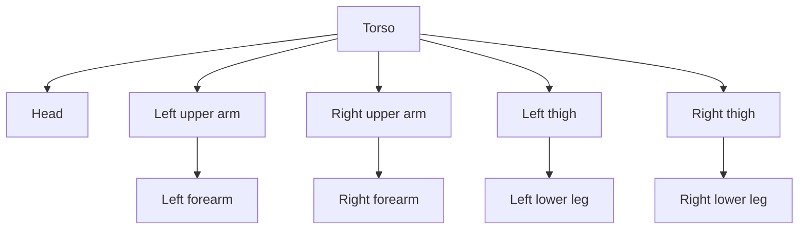

# 1. Understand the assignment

[Guide index](README.md) · [Next: rendering setup](02-rendering-setup.md)

## What you are learning

Hierarchical modeling describes an object using relationships. The torso is the
parent of an upper arm, and the upper arm is the parent of a forearm. Each child's
position is expressed relative to its parent. A parent matrix then carries all its
children into world space.

A transformation changes a coordinate system: translation moves its origin,
rotation turns its axes, and scaling changes distances along those axes. A matrix
combines these operations into one calculation. A matrix stack remembers the
coordinate systems you need to return to while drawing different branches.

Your model consists of rigid cubes transformed into body parts. Each part moves
as a whole around a joint. Smooth deformation of a continuous skin mesh is a
different topic; the mandatory exercise is already achievable with rigid parts.

## Translate the requirements into demonstrations

| Requirement from the supplied assignment | What you must show |
| --- | --- |
| Your own matrices and transformations | Explain your multiplication, translation, rotation, and scaling implementations. |
| Your own matrix stack | Show where you save and restore a parent's matrix. |
| OpenGL at least 4.0 | Report the actual context version; this guide requests 4.1 core. |
| Correct articulation | Rotate the torso and watch every part follow; rotate one upper arm and watch only its forearm follow it. |
| Automatic repositioning after resizing | Change an upper-arm length and show the elbow remains connected. |
| Required body parts | Show all ten parts, with upper and lower limb segments drawn separately. |
| Walk, jump, and stay put | Select and demonstrate all three behaviors. |
| One function call per body part | Show ten calls to the same unit-shape drawing function per body render. |
| Unit shape at the current origin | Show fixed unit-cube vertices and how matrices produce all dimensions/positions. |
| Makefile or equivalent | Build from a clean checkout using documented prerequisites. |
| Repository submission | Include code, shaders, required generated loader files, and instructions in Git. |

The program's window is not evidence that the hierarchy works. The articulation
and resizing demonstrations are what expose incorrect relationships.

## The ten parts

The count is `1 torso + 1 head + 4 arm segments + 4 leg segments = 10`.
Shoulders, elbows, hips, and knees are coordinate frames; they do not need extra
visible objects. A separate foot, hand, or neck would be an additional part.

For a plain-text reading: all five branches start at the torso. Four branches
contain two limb segments; the remaining branch contains the head.

## Research task

Read the introduction to [GLFW](https://www.glfw.org/docs/latest/). Identify what it
provides: windows, contexts, and input. Then list what remains your responsibility:
matrices, hierarchy, geometry, shaders, and animation. This prevents confusing a
windowing library with a modeling or animation library.

The assignment's references to `glRotate` and `glPushMatrix` describe an older
OpenGL approach. Your program will calculate matrices on the CPU, send them to
shaders, and keep its stack in ordinary CPU memory.

## Exercise and checkpoint

Draw the hierarchy on paper. Next to every part, write its parent and pivot.
Predict which parts change when you rotate the torso, left shoulder, and left
elbow. The expected affected sets are respectively all ten parts, two left-arm
segments, and only the left forearm.

Write a ten-item drawing checklist. You should be able to point to exactly one
unit-cube function call for each item in the future traversal.

## Common mistakes

- Placing every part using independent world coordinates makes resizing and parent motion fragile.
- Adding attractive bonus features before articulation works puts the evaluated core at risk.
- Drawing a cube face by face with six draw calls complicates the drawing constraint; use one indexed draw for the complete cube.

## Explain it aloud

Why should an elbow be described relative to an upper arm? How does changing the
torso differ from changing one forearm? Which requirements need numerical proof,
and which need a visible demonstration?
